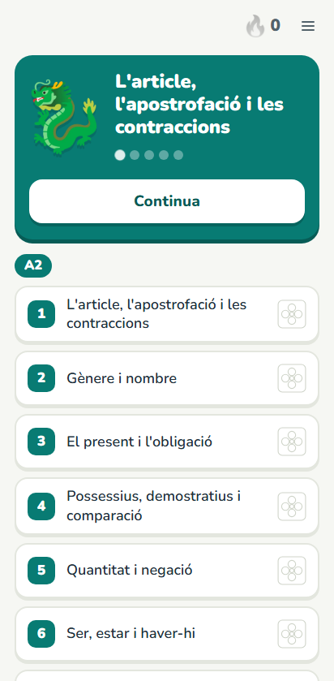
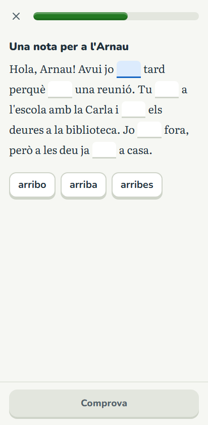
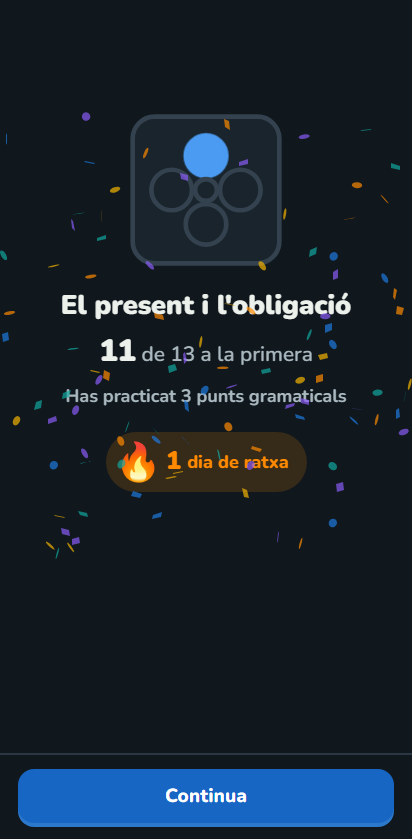

# Català

App para aprender catalán de A2 a B2: 60 unidades con gramática explícita, ejercicios de ocho
tipos y repaso espaciado de los errores. Explicaciones en catalán, variante central (norma IEC).

<p align="center">
  <a href="https://github.com/iggykimi/catala/releases/download/v1.0/catala.apk"><strong>⬇ Descarga la APK (Android)</strong></a>
</p>

<p align="center">
  
  
  
</p>

## Qué tiene

- 60 unidades (A2, B1, B2) con la teoría en tarjetas y 3.902 ejercicios.
- Ocho tipos de ejercicio; corrección tolerante con los acentos y estricta con la ortografía.
- Repaso espaciado por punto gramatical, racha diaria, sonido y vibración.
- Sesiones recuperables, tema claro/oscuro y copia del progreso en archivo.
- Funciona sin conexión; sin cuentas ni servidores.

## Desarrollo

```bash
npm install
npm test                         # tests del corrector y del validador
npm run typecheck
npm run validate                 # 60 unidades, 0 errores
npm run dev                      # la app en el navegador
npm run e2e                      # juega todas las lecciones en un móvil simulado
```

La prueba completa juega las 60 unidades en paralelo (un test por unidad): 72 tests en
menos de 2 minutos.

## APK (Android)

```bash
npm install
npm run build
npx cap add android   # solo la primera vez
npx cap sync
npx cap open android  # compila y genera la APK desde Android Studio
```

Tras cambiar contenido o código: `npm run build && npx cap sync`.

## Documentación

- [Currículo](docs/curriculo.md): las 60 unidades.
- [Tipos de ejercicio y corrección](docs/tipos-ejercicio.md)
- [Guía de autoría](docs/guia-autoria.md)
- [Interfaz](docs/interfaz.md): por qué cada elemento está ahí.
- [Siguientes pasos](docs/siguientes-pasos.md)

Estado y estructura del proyecto en [`AGENTS.md`](AGENTS.md).

Ilustraciones: el drac y el foc son de Noto Emoji (Google, CC BY 4.0); el crédito también está en
la app.
